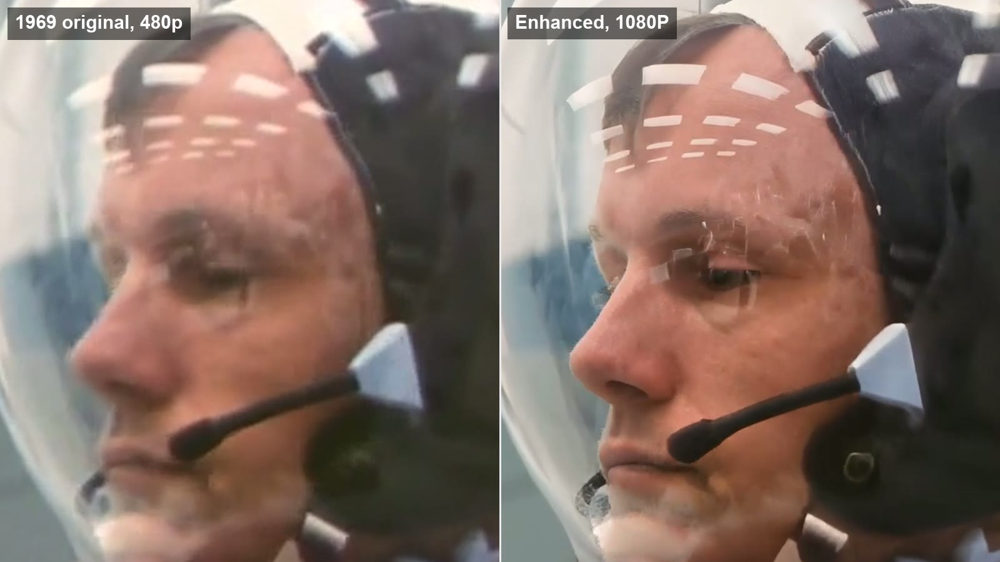
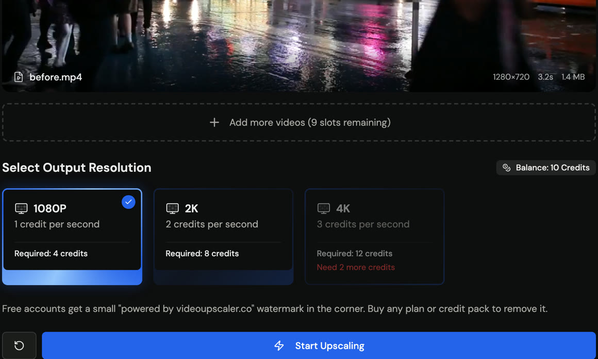
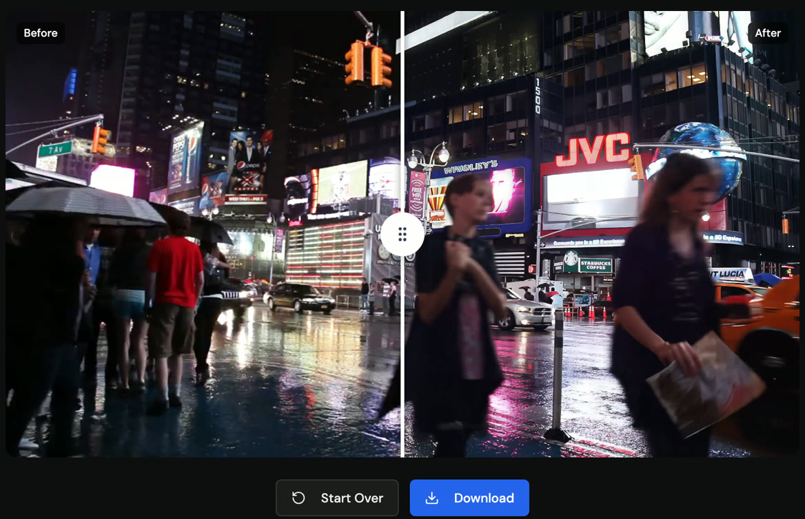

<p align="center">
  <a href="https://videoupscaler.co"></a>
</p>

<h1 align="center">AI Video Upscaler</h1>

<p align="center">
  Turn blurry, low-resolution video into sharp <b>1080p, 2K or 4K</b>, in your browser, from your code, or by asking your AI assistant.
</p>

<p align="center">
  <a href="https://videoupscaler.co"><b>Try it free</b></a> ·
  <a href="https://videoupscaler.co/docs">API docs</a> ·
  <a href="https://videoupscaler.co/docs/mcp">MCP server</a> ·
  <a href="https://videoupscaler.co/pricing">Pricing</a>
</p>

<p align="center">
  
</p>

[VideoUpscaler](https://videoupscaler.co) is an online AI video upscaler. Upload a video, pick a resolution, and download a sharper version a few minutes later. There's nothing to install and you don't need a graphics card: the AI runs on our GPUs, not on your computer.

This repository is the public home of the product: how to use it, which AI model it runs, ready-to-copy examples for the [REST API](#3-rest-api-for-developers) and [MCP server](#2-mcp-server-ask-your-ai-assistant), and an [agent skill](skills/video-upscaler/SKILL.md).

## Contents

- [What it does](#what-it-does)
- [What you need](#what-you-need)
- [Three ways to use it](#three-ways-to-use-it)
  - [1. Website (no code)](#1-website-no-code)
  - [2. MCP server (ask your AI assistant)](#2-mcp-server-ask-your-ai-assistant)
  - [3. REST API (for developers)](#3-rest-api-for-developers)
- [The AI model](#the-ai-model)
- [Pricing](#pricing)
- [Limits](#limits)
- [FAQ](#faq)

## What it does

- **Upscales video to 1080p, 2K or 4K.** Old home movies, 480p/720p downloads, phone clips, screen recordings, anime and game footage.
- **Restores detail, not just pixels.** Plain resizing only stretches a blurry frame. The AI model rebuilds edges, faces, textures and text, and reduces blur, noise and compression blocks.
- **Keeps the video stable.** Frames are processed as a video, not as separate photos, so details don't flicker from one frame to the next.
- **Keeps your audio.** The soundtrack is copied to the result unchanged.
- **Works everywhere.** Any modern browser on Windows, macOS, Linux, iPhone, iPad or Android.

## What you need

| | Website | MCP server | REST API |
| --- | --- | --- | --- |
| Device | Any computer, tablet or phone with a modern browser (Chrome, Safari, Edge, Firefox) | A computer running an MCP client: Claude, Claude Code, Cursor, VS Code or any other client that supports remote MCP servers | Any machine that can send HTTPS requests (curl, Node.js, Python, Go...) |
| Graphics card (GPU) | Not needed | Not needed | Not needed |
| Software to install | None | Only the AI client you already use | None (no SDK required) |
| Account | Free account, 10 free credits to try | Account that has bought credits | Account that has bought credits + an API key |
| Video formats | MP4, MOV, WebM | MP4, MOV, WebM | MP4, MOV, WebM |

All the heavy lifting (decoding, AI inference, encoding) happens on our GPUs. A five-year-old laptop gets exactly the same result as a high-end workstation.

## Three ways to use it

### 1. Website (no code)

Best for: anyone who just wants a sharper video.

1. Go to **[videoupscaler.co](https://videoupscaler.co)** and sign in with Google or your email. New accounts get **10 free credits**.
2. Drop your video into the upload box (or click to choose a file).
3. Pick **1080P**, **2K** or **4K**. The page shows how many credits the video needs before you start.

   

4. Click **Start Upscaling**. Keep the tab open, or come back later: finished videos stay in your history.
5. Drag the slider to compare before and after, then click **Download**.

   

Tips for the best result:

- Upload the **original file**, not a re-downloaded or screen-recorded copy. Every re-encode throws detail away.
- **Try a short clip first** (5–10 seconds) to check the look before you upscale a long video.
- **1080p is enough** for most 480p/720p sources. Choose 2K or 4K when you'll watch on a large screen or edit in a 4K timeline.

Free results carry a small "videoupscaler.co" watermark. After your first purchase, new results have no watermark.

### 2. MCP server (ask your AI assistant)

Best for: people who already work in Claude, Cursor or VS Code and want to say *"upscale this video to 4K"* instead of opening a website.

**Server URL:** `https://videoupscaler.co/api/mcp` (Streamable HTTP). It's listed in the official [MCP Registry](https://registry.modelcontextprotocol.io) as `co.videoupscaler/video-upscaler`.

Most clients connect by signing in: add the URL, a browser window opens, you sign in to VideoUpscaler and click **Allow**. Clients that can't sign in use an API key from [Settings → API Keys](https://videoupscaler.co/sign-in?callbackUrl=%2Fsettings%2Fapikeys).

<details open>
<summary><b>Claude (claude.ai and the desktop app)</b></summary>

Open **Settings → Connectors → Add custom connector**, enter `https://videoupscaler.co/api/mcp`, click **Connect**, then sign in and allow access.
</details>

<details>
<summary><b>Claude Code</b></summary>

```bash
claude mcp add --transport http videoupscaler https://videoupscaler.co/api/mcp --scope user
```

Then run `/mcp`, select `videoupscaler` and choose **Authenticate**. To use an API key instead, add `--header "Authorization: Bearer $VIDEOUPSCALER_API_KEY"`.
</details>

<details>
<summary><b>Cursor</b> (API key)</summary>

Add to `~/.cursor/mcp.json` ([example file](examples/mcp/cursor.json)):

```json
{
  "mcpServers": {
    "videoupscaler": {
      "url": "https://videoupscaler.co/api/mcp",
      "headers": {
        "Authorization": "Bearer ${env:VIDEOUPSCALER_API_KEY}"
      }
    }
  }
}
```
</details>

<details>
<summary><b>VS Code</b></summary>

Add to `.vscode/mcp.json` ([example file](examples/mcp/vscode.json)). VS Code asks you to sign in the first time:

```json
{
  "servers": {
    "videoupscaler": {
      "type": "http",
      "url": "https://videoupscaler.co/api/mcp"
    }
  }
}
```
</details>

<details>
<summary><b>Other clients</b></summary>

Any client that supports remote MCP servers over Streamable HTTP works. Clients that support MCP authorization sign in automatically; others send the header `Authorization: Bearer <your API key>`.
</details>

**Tools**

| Tool | What it does |
| --- | --- |
| `upscale_video` | Upscales a public `video_url` to `1080p`, `2k` or `4k`. Requires an `idempotency_key` so a retry never charges twice. |
| `get_task` | Returns a task. With `wait_seconds` (up to 45) it waits for the task to finish first. |
| `list_tasks` | Lists your recent tasks, including ones started on the website. |
| `get_account` | Your credit balance and the price per second for each resolution. |
| `create_upload` | Returns a signed URL for uploading a local file (up to 100MB) that has no public URL. |

**Try asking**

- "How many VideoUpscaler credits do I have left?"
- "Upscale https://example.com/clip.mp4 to 4K and give me the link when it's done."
- "Upscale `./intro.mp4` to 2K." (clients that can run commands upload the file with `create_upload` first)

### 3. REST API (for developers)

Best for: apps, scripts and pipelines that upscale videos automatically.

1. Buy any credit pack on the [pricing page](https://videoupscaler.co/pricing) (this unlocks the API for good).
2. Create a key in [Settings → API Keys](https://videoupscaler.co/sign-in?callbackUrl=%2Fsettings%2Fapikeys) and store it as `VIDEOUPSCALER_API_KEY`.
3. Start an upscale, then poll the task until it's `completed`:

```bash
curl https://videoupscaler.co/api/v1/upscale \
  -H "Authorization: Bearer $VIDEOUPSCALER_API_KEY" \
  -H "Content-Type: application/json" \
  -H "Idempotency-Key: my-first-upscale" \
  -d '{"video_url": "https://example.com/clip.mp4", "resolution": "2k"}'
```

```bash
curl https://videoupscaler.co/api/v1/tasks/TASK_ID \
  -H "Authorization: Bearer $VIDEOUPSCALER_API_KEY"
# -> "status": "completed", "output_url": "https://..."
```

| Endpoint | What it does |
| --- | --- |
| `POST /api/v1/upscale` | Start an upscale from a video URL |
| `GET /api/v1/tasks/{id}` | Get a task's status and result |
| `GET /api/v1/tasks/{id}/events` | Stream progress as Server-Sent Events |
| `GET /api/v1/tasks` | List your tasks |
| `GET /api/v1/account` | Credit balance and prices |
| `POST /api/v1/uploads` | Get a signed URL to upload a local file |

Full examples: [curl](examples/curl.sh) · [Node.js](examples/node.mjs) · [Python](examples/python.py). Machine-readable spec: [openapi.yaml](openapi.yaml). Reference: [videoupscaler.co/docs](https://videoupscaler.co/docs).

Videos that aren't online yet: call `POST /api/v1/uploads`, `PUT` the file to the returned `upload_url`, then pass the returned `video_url` to `/upscale` (see the [Node.js example](examples/node.mjs)).

## The AI model

VideoUpscaler runs **[FlashVSR](https://github.com/OpenImagingLab/FlashVSR)**, a diffusion-based video super-resolution model (CVPR 2026, Apache-2.0).

| | |
| --- | --- |
| Model type | One-step diffusion video super-resolution |
| Why this model | Diffusion models generate realistic texture (skin, hair, foliage, fabric) instead of the smooth, plastic look of older upscalers |
| Temporal consistency | It processes video as a stream of frames, so detail stays stable over time instead of flickering frame to frame |
| Output | 1080p, 2K or 4K, encoded as MP4 with the original audio |
| Runs on | Our data-center GPUs. You never download weights or need your own GPU |

How it compares with classic upscalers:

| Approach | Example | Result on real-world video |
| --- | --- | --- |
| Interpolation | Bicubic / Lanczos resize in an editor | Bigger but just as blurry |
| GAN image upscaler, frame by frame | Real-ESRGAN | Sharp stills, but detail can shimmer between frames |
| Diffusion video upscaler | **FlashVSR (VideoUpscaler)** | Realistic detail that stays consistent across frames |

AI upscaling recovers plausible detail; it can't invent information that was never captured. A heavily compressed 240p clip will look much better, but not like it was filmed in 4K.

## Pricing

You pay per second of video with credits. The same credits work on the website, the API and the MCP server.

| Resolution | Credits per second |
| --- | --- |
| 1080p | 1 |
| 2K | 2 |
| 4K | 3 |

A 12.4-second clip costs 13 credits at 1080p, 26 at 2K and 39 at 4K (length is rounded up). If a job fails, its credits are refunded automatically. New accounts get 10 free credits; credit packs and plans are on the [pricing page](https://videoupscaler.co/pricing).

## Limits

| | Limit |
| --- | --- |
| Video length (API/MCP) | 1200 seconds at 1080p, 600 seconds at 2K and 4K |
| Remote `video_url` size (API/MCP) | 500MB |
| Upload through `/uploads` | 100MB |
| API requests | About 120 per minute per key |

## FAQ

**Do I need a powerful computer or a graphics card?**
No. Processing runs on our GPUs. You only upload the video and download the result.

**How long does it take?**
It depends on the video's length and the resolution. A short clip at 1080p usually finishes in a few minutes; a long video at 4K takes longer. You can close the tab and come back later.

**How long are my files kept?**
Files uploaded through the API may be deleted after 7 days. Download your result soon and keep your own copy.

**Can I upscale anime or cartoons?**
Yes. Try a short clip first to check the look before you upscale a whole episode.

**Does it change the frame rate or the length?**
No. The result has the same frame rate, length and audio as the original.

**Why can't I use the API with the free credits?**
The API and MCP upscaling tools are for accounts that have bought credits or subscribed. Any account can sign in to the MCP server and check its balance.

## Links

- Website: [videoupscaler.co](https://videoupscaler.co)
- API reference: [videoupscaler.co/docs](https://videoupscaler.co/docs)
- MCP setup: [videoupscaler.co/docs/mcp](https://videoupscaler.co/docs/mcp)
- Blog: [videoupscaler.co/blog](https://videoupscaler.co/blog)

The examples and docs in this repository are MIT-licensed. The VideoUpscaler service itself is a hosted product; see the website's terms.
